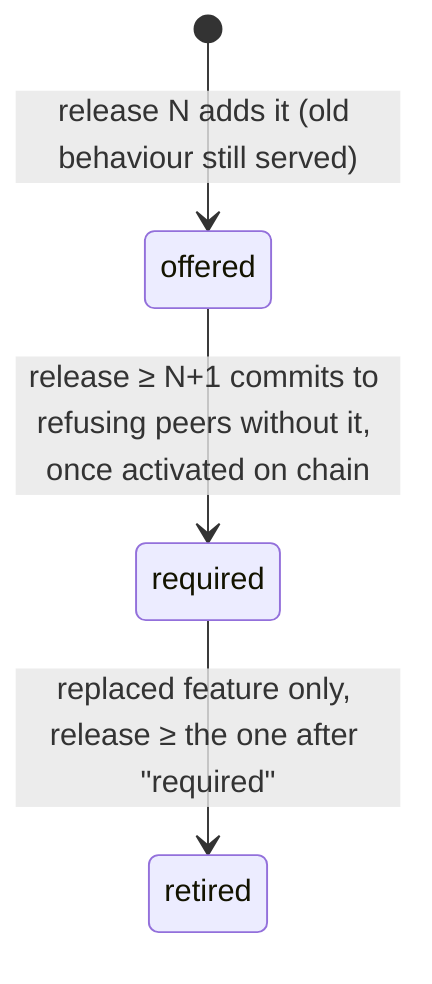

# Protocol compatibility

Symposia nodes are run by independent operators who upgrade on their own schedule. Every change to how nodes, gateways and contracts talk to each other has to keep working while the network runs a mix of versions. This page holds the rules every contributor follows and the CI checks that enforce them.

- **What the product requires:** [Requirements/Network/protocol-upgrades-and-staggered-releases.md](../../Requirements/Network/protocol-upgrades-and-staggered-releases.md)
- **Tenant-facing APIs (S3, Azure, platform `/v1`):** [Requirements/Platform/api-versioning-policy.md](../../Requirements/Platform/api-versioning-policy.md). This page covers node-to-node protocols only.
- **Issues:** #145 (mechanism), #146 (enforcement).

## The rules

1. **Support the current release and the one before it (N-1).** A node or gateway at release N must work with peers at release N-1, in both directions.
2. **Never remove a behaviour in the same release that adds its replacement.** Overlap first: serve old and new side by side for at least one release.
3. **Breaking requirements switch on at an on-chain activation, never through local configuration.** One public deadline per network, the same rule on every gateway, and a public record of each change.
4. **Activations are announced in advance.** The contract enforces a notice window. Security fixes may shorten the overlap, but still go through activation.
5. **Consumers ignore what they don't understand.** Unknown JSON fields, unknown enum values and unknown feature names are tolerated, never errors.

## Protocol features

A **protocol feature** is a named behaviour a node can offer, such as `storage.grpc.tls`. They are called *protocol features* to avoid confusion with the consent `CapabilityRegistry` contract.

- The registry of features is [`protocol/features.json`](../../protocol/features.json). Code refers to a feature only through the constants in [`ProtocolFeatures`](../../Network/Symposia.Network.Node/ProtocolFeatures.cs).
- Nodes advertise `protocolVersion` and `features` in `GET /v1/node/services`.
- Names are namespaced by role (`storage.*`, `compute.*`). A gateway checks a storage node only against `storage.*` activations.

### Lifecycle



| Stage | Meaning | Code may… |
|---|---|---|
| `offered` | Advertised. Peers use it when both sides support it. Any legacy alternative is still served. | prefer it, but must work without it |
| `required` | Gateways refuse peers that lack it **once its on-chain activation is in effect**. | assume it after activation |
| `retired` | A legacy feature whose code has been removed. Kept in the registry as history. | not reference it |

Each feature records its history: `[{ "stage": ..., "release": ... }]`. Rules checked by CI:

- A feature is never deleted from the registry.
- Each new history entry moves exactly one stage forward, at a release strictly later than the previous entry. That means at most one step per release.
- A feature is retired only if its replacement (`replaces`) became `required` in an earlier release. A feature with no replacement must itself have been `required` in an earlier release.
- `protocolVersion` and `release` never decrease.

### Adding a protocol change, step by step

1. **Release N:**
   - Add the feature to `features.json` with `offered` at the current `release`, plus a constant in `ProtocolFeatures`.
   - Implement the new behaviour alongside the old one.
   - Advertise the feature only when it is actually served.
   - Bump `protocolVersion` if the change alters node-to-node behaviour.
2. **Release N+1 or later:** append `required` at that release. Code may now rely on the feature once it is activated.
3. **Governance** schedules the activation on each network: Dev first, then Testnet, then Mainnet. See [Activating a feature](#activating-a-feature) below.
4. **The release after `required`:** append `retired` to the *old* feature, and delete its code.

Worked example (#142 → #145): `storage.grpc.tls` (offered 0.1.0) replaces `storage.grpc.plaintext`.
1. Storage nodes serve both ports.
2. `storage.grpc.tls` becomes `required` in a later release, and governance activates it.
3. In the release after that, `storage.grpc.plaintext` is retired and the cleartext listener is removed.

## On-chain activation

[`ProtocolActivations`](../../Blockchain/bootstrap-chain/src/ProtocolActivations.sol) holds, per feature name, the time it becomes required, plus a minimum protocol version.
- **Owner:** the foundation key, until governance (#54).
- **Notice:** `minNotice`, fixed at deployment. It is 0 for LocalDev and should be at least 7 days for Testnet and Mainnet.
- **Changes:** an activation can be postponed or cancelled before it takes effect. It can never be moved earlier, and it is permanent once in effect. The minimum version only rises.
- **Record:** every change emits an event.
- **Reading:** the Blockchain Gateway serves the schedule at `GET /v1/protocol` and the contract address in `GET /v1/network`.
- **Gateway enforcement** (`NetworkPolicy`):
  - Before activation, a node lacking the feature is used, and a warning is logged on each refresh.
  - After activation, the node is refused and dropped immediately.
  - Activations the gateway has seen in effect are never forgotten, even if the Blockchain Gateway later becomes unreachable or reports otherwise.
  - A bad TLS proof refuses the node; it is never a reason to fall back to cleartext.

### Activating a feature

1. Check readiness: Node Host → **Network** tab → *Protocol activations* shows each scheduled feature with "N of M storage nodes ready", and flags nodes that will be refused.
2. Schedule it, as the owner:
   ```sh
   cast send <ProtocolActivations> 'schedule(string,uint64)' storage.grpc.tls <unix-time> \
     --rpc-url <rpc> --private-key <owner-key>
   ```
3. Announce the time to operators. The `FeatureScheduled` event is the public record.
4. To postpone, call `schedule` again with a later time. To withdraw, call `cancel(name)`. Both work only before the activation takes effect.

## The checks

Each check names its rule in the failure message. Fix the change, not the check.

| Check | Where | Catches | How to fix |
|---|---|---|---|
| **Build and tests** | `ci.yml` | Any failing test suite or `forge test` | Run the suite locally (commands in [CONTRIBUTING.md](../../CONTRIBUTING.md)) |
| **gRPC breaking changes** | `protocol-compat.yml`: `buf breaking` (`WIRE_JSON`) against the base branch and latest release tag | Removed, renamed or retyped proto fields; reused field numbers; removed RPCs | Add new fields with new numbers; mark old ones `deprecated` and stop using them; never reuse a number (`reserved` it) |
| **JSON schema compatibility** | `protocol-compat.yml`: `tools/protocol-compat` `schema` | A property in `protocol/schemas/*.json` removed, retyped, made non-nullable or made required, or `additionalProperties: false` added | Add a new optional property instead; keep the old one populated during the overlap |
| **Golden fixtures** | `protocol-compat.yml` `fixtures` + `ProtocolContractTests` | A fixture in `protocol/fixtures/` deleted or edited; a fixture that no longer parses or validates; a C# record property missing from its schema | Fixtures are history: add a new one for the new shape and keep the old ones passing; add the property to the schema |
| **Feature registry lifecycle** | `protocol-compat.yml` `registry` | The [lifecycle rules](#lifecycle) | Append a history entry at the next release; retire only after the replacement was required in an earlier release |
| **Feature constants** | `ProtocolContractTests` | A `ProtocolFeatures` constant missing from the registry, a non-retired registry feature with no constant, or a retired feature still referenced | Keep `ProtocolFeatures.cs` and `features.json` in step |
| **No local policy switches** | `ProtocolContractTests` | A new public `bool Require*` property on an `*Options` type | Put peer-acceptance rules in `NetworkPolicy`, driven by an activation. If the switch is genuinely node-local, add it to `protocol/options-allowlist.json` with a reason (CODEOWNERS review) |
| **Contract storage layout** | `protocol-compat.yml` `storage-layout` | An existing slot changed, moved or retyped in an upgradeable (`GovernedUpgradeable`) contract; a stale snapshot | Only append state variables; run `tools/protocol-compat/storage-layout.sh --write` and commit the snapshot |
| **Destructive migrations** | `protocol-compat.yml` `migrations` | Added `DROP TABLE`, `DROP COLUMN` or `RENAME` in metadata or migration code | Expand/contract: add the new column, dual-write, stop reading the old one, then drop it in a later release. A maintainer applies the `migration-contract-approved` label for the final drop |
| **Mixed-version cluster** | `mixed-version.yml` | Release N and N-1 hosts that can't upload, download, replicate or repair together | Restore N-1 behaviour behind the overlap; see the smoke log artifact |
| **Maintainer review** | `CODEOWNERS` + `protocol-change` label | Semantic changes no tool can see: same field with a new meaning, new timing, new ordering | Explain the compatibility story in the PR template |

Run all the diff checks locally against your base branch:

```sh
tools/protocol-compat/run.sh origin/dev
```

## Releases

`protocol/features.json` → `release` is the release being built. When cutting a release:
1. Tag `master` as `v<release>`.
2. Bump `release` in `features.json` on `dev`.

The mixed-version job compares each PR against the latest `v*` tag. Until the first tag exists, it reports "no release baseline yet" and passes.
